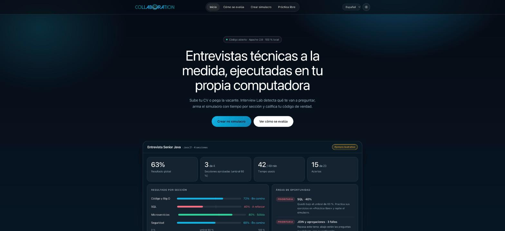
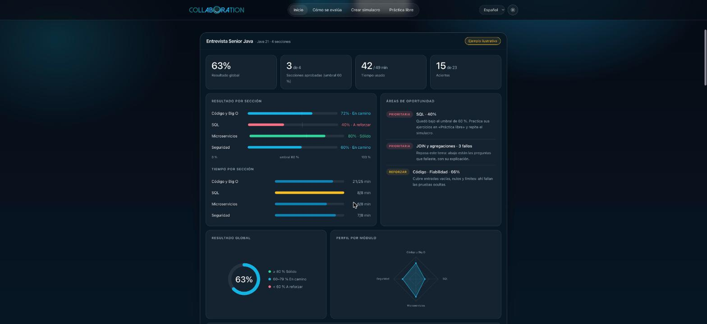
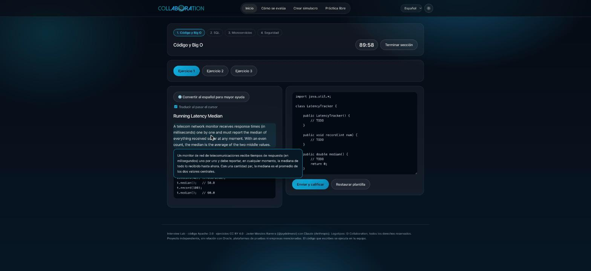
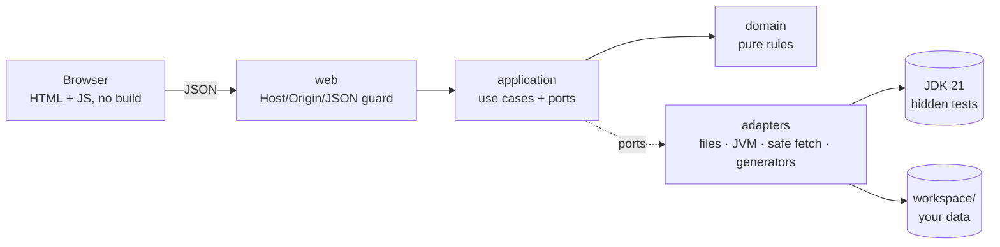

# Interview Lab

[](https://github.com/jaydelmoral/interview-lab/actions/workflows/ci.yml)


🇪🇸 [README en español](README.md)

**A local technical-interview simulator that builds an exam tailored to the role you are applying for.**
Paste the job description or your CV, choose seniority, language and modules, and practice with a **timer per section**, **hidden tests** that compile and run your Java code, and a report of **what to reinforce**. Everything runs on your machine: your CV is never sent anywhere.



## What problem does it solve?
Technical interviews fail for predictable reasons: no IDE, time pressure, forgotten edge cases, unfamiliar question formats and **misreading the English statement**. Interview Lab lets you rehearse exactly that, with the kind of exam *your* target role asks for.

## Features
- **Tailored simulations:** local analysis (no AI, no internet) of a CV or job description → detects seniority, language/version and modules; you adjust.
- **Modules:** coding and Big O, "predict the output" (Java 8–21), SQL, QA (TDD and BDD), microservices, DevOps, architecture, security, Unix. *(AI/LLMs: coming soon.)*
- **Timer per section** (standard, tight −20%, relaxed +25%), resumable.
- **Real grader:** compiles and runs hidden tests on a JVM, with timings, and explains *what failed, why, and how to improve*.
- **Bilingual ES/EN** and **Spanish help** for English statements: a translate button or a hover pop-up.
- **My bank:** paste links (safely fetched) or notes and turn them into questions and flashcards. Local generation; **optional AI with your own key**.
- **Your own exercises:** template + validator; your data stays in `workspace/`, outside git.
- **Results dashboard:** before you start you see how you are scored (a labelled sample); when you finish, your real report with KPIs, result per section, time, profile by module, prioritised **opportunity areas** and the questions to review. Saves as PDF.
- Light/dark mode with a switch (follows your system until you choose) and the matching logo for each mode.





## Quick start
```bash
git clone https://github.com/jaydelmoral/interview-lab.git
cd interview-lab
docker compose up --build      # open http://localhost:8765
```
Without Docker: JDK 21 + Python 3.9+ → `python3 server.py`. Details, variables and troubleshooting: **[docs/INSTALL.md](docs/INSTALL.md)**. Usage guide with screenshots: **[docs/USER-GUIDE.md](docs/USER-GUIDE.md)**.

## Architecture in one picture
One Python process (standard library only), **hexagonal** architecture, content as data.


C4 diagrams, sequences, data model and deployment: **[docs/architecture/](docs/architecture/README.md)**.

## Design decisions (ADRs)
Every significant decision is documented: [14 ADRs](docs/architecture/adr/README.md). A few:
| Decision | ADR |
|---|---|
| Local-first, single process, standard library only | [0002](docs/architecture/adr/0002-local-first-single-process.md) |
| Hexagonal layering with ports | [0003](docs/architecture/adr/0003-hexagonal-layering.md) |
| JVM-per-test grading + hardened container | [0004](docs/architecture/adr/0004-jvm-subprocess-grading-and-container-hardening.md) |
| Reproducible exam; answers stay on the server | [0007](docs/architecture/adr/0007-exam-as-reproducible-definition.md) |
| Same-origin guard (CSRF and DNS rebinding) | [0008](docs/architecture/adr/0008-same-origin-guard.md) |
| SSRF-safe link fetching | [0009](docs/architecture/adr/0009-ssrf-safe-link-fetching.md) |
| AI as an optional port, with the user's own key | [0011](docs/architecture/adr/0011-optional-ai-generator-port.md) |

## Quality and security
- **45 automated tests** (domain, adapters, end-to-end API and real JVM) plus a content validator in CI.
- Server on `127.0.0.1` only; checks `Host` and `Origin`; code is graded without your environment variables and with time and memory limits; unprivileged, read-only container.
- **Not a sandbox for hostile code** and must not be exposed to the internet. Threat model: **[docs/SECURITY-MODEL.md](docs/SECURITY-MODEL.md)**.

## Add your own exercises
```bash
python3 tools/new_problem.py my-exercise "My Title" --domain retail
python3 tools/validate.py my-exercise
```
Use a **sector** (airline, bank…) instead of company names and write in your own words: **[docs/CONTENT-GUIDELINES.md](docs/CONTENT-GUIDELINES.md)**. You are responsible for the rights to what you add.

## Documentation
[Index](docs/README.md) · [User guide](docs/USER-GUIDE.md) · [Install](docs/INSTALL.md) · [Architecture](docs/architecture/README.md) · [ADRs](docs/architecture/adr/README.md) · [API](docs/API.md) · [Security](docs/SECURITY-MODEL.md) · [Roadmap](docs/ROADMAP.md) · [Contributing](CONTRIBUTING.md)

## Licenses, authorship and notices
- **Code:** [Apache-2.0](LICENSE). **Exercises, quiz and texts:** [CC BY 4.0](LICENSE-CONTENT.md) (official text in `LICENSE-CONTENT.txt`). **Collaboration logos and brand: all rights reserved**, not covered by those licenses; forks must replace them (`web/brand/brand.json`).
- Authors: **Javier Morales Barrera ([@jaydelmoral](https://github.com/jaydelmoral))**, created together with **Claude** (an AI assistant by Anthropic). See [AUTHORS.md](AUTHORS.md) and [NOTICE](NOTICE).
- Independent project: **not affiliated with, sponsored or endorsed by** Oracle, the owners of Java®, Spring or other trademarks, or any code-testing platform. Trademarks belong to their owners and are used only to identify technologies.
- Exercises are original (classic algorithmic ideas with our own statements, data and business settings). No warranty (see Apache-2.0); practicing here does not guarantee results in any interview.
- The concept bank and questions were drafted with AI help: **check them against official documentation**.
