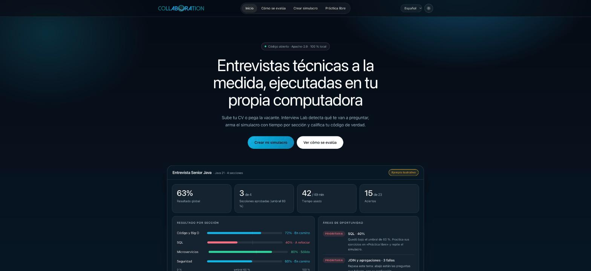
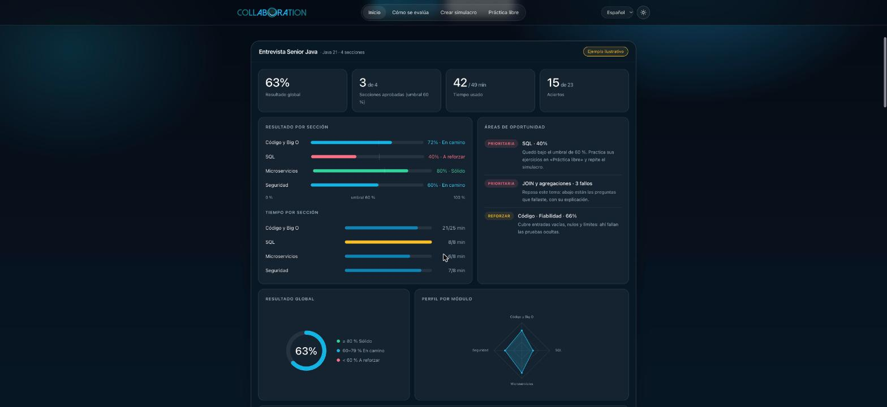
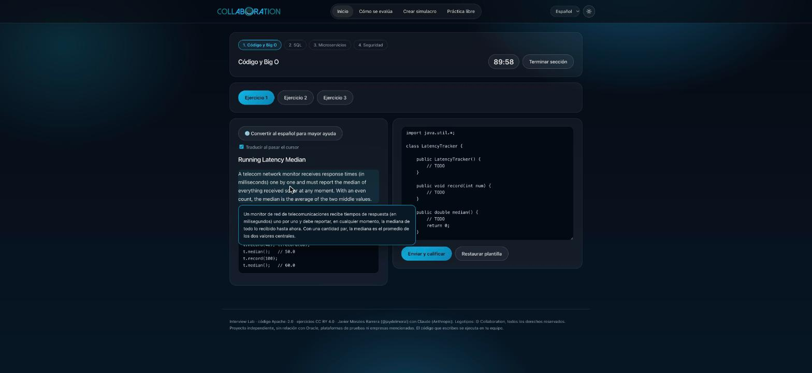
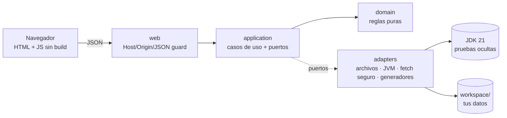

# Interview Lab

[](https://github.com/jaydelmoral/interview-lab/actions/workflows/ci.yml)


🇬🇧 [English README](README.en.md)

**Simulador local de entrevistas técnicas que arma un examen a la medida del puesto que buscas.**
Pega la vacante o tu CV, elige seniority, lenguaje y módulos, y practica con **temporizador por sección**, **pruebas ocultas** que compilan y ejecutan tu código Java y un reporte de **qué reforzar**. Todo corre en tu equipo: tu CV no se envía a ningún lado.



## ¿Qué problema resuelve?
Las entrevistas técnicas fallan por razones previsibles: no tener IDE, la presión del tiempo, casos borde olvidados, formatos de pregunta desconocidos y **leer mal el enunciado en inglés**. Interview Lab te deja ensayar justo eso, con el tipo de examen que pide *tu* vacante.

## Características
- **Simulacros a la medida:** análisis local (sin IA ni internet) de CV o vacante → detecta seniority, lenguaje/versión y módulos; tú ajustas.
- **Módulos:** código y Big O, "predice la salida" (Java 8–21), SQL, QA (TDD y BDD), microservicios, DevOps, arquitectura, seguridad, Unix. *(IA/LLMs: próximamente.)*
- **Temporizador por sección** (estándar, exigente −20 %, relajado +25 %), reanudable.
- **Calificador real:** compila y ejecuta pruebas ocultas en una JVM, con tiempos, y explica *qué falló, por qué y cómo mejorar*.
- **Bilingüe ES/EN** y **ayuda en español** para enunciados en inglés: botón para traducir o recuadro al pasar el cursor.
- **Mi banco:** pega enlaces (con lectura segura) o apuntes y conviértelos en preguntas y tarjetas. Generación local; **IA local opcional con Ollama** (tu texto no sale de tu equipo) o con tu propia llave en la nube.
- **Banco con fuentes:** cada pregunta cita documentación oficial y lleva estado de revisión (borrador/revisada); niveles Senior, Staff y Principal; bancos grandes como *paquetes* privados aparte (`packs/`).
- **Historial:** tus simulacros y envíos quedan en SQLite local, con tendencias y temas débiles.
- **Instalador de lenguajes** (`python3 install.py`): tú decides qué instalar; la app nunca instala nada. PDF opcional con `pdftotext`.
- **Tus propios ejercicios:** plantilla + validador; los datos quedan en `workspace/`, fuera de git.
- **Tablero de resultados:** antes de empezar ves cómo se evalúa (ejemplo etiquetado); al terminar, tu reporte real con KPIs, resultado por sección, tiempo, perfil por módulo, **áreas de oportunidad** priorizadas y las preguntas a repasar. Se guarda como PDF.
- Modo claro/oscuro con botón (sigue tu sistema hasta que eliges) y el logotipo de cada modo.





## Inicio rápido
```bash
git clone https://github.com/jaydelmoral/interview-lab.git
cd interview-lab
docker compose up --build      # abre http://localhost:8765
```
Sin Docker: JDK 21 + Python 3.9+ → `python3 server.py`. Detalles, variables y solución de problemas: **[docs/INSTALL.md](docs/INSTALL.md)**. Guía de uso con capturas: **[docs/USER-GUIDE.md](docs/USER-GUIDE.md)**.

## Arquitectura en una imagen
Un solo proceso Python (solo biblioteca estándar), arquitectura **hexagonal** y contenido como datos.


Diagramas C4, secuencias, modelo de datos y despliegue: **[docs/architecture/](docs/architecture/README.md)**.

## Decisiones de diseño (ADR)
Cada decisión importante está documentada: [14 ADR](docs/architecture/adr/README.md). Algunas:
| Decisión | ADR |
|---|---|
| Local primero, un proceso, solo biblioteca estándar | [0002](docs/architecture/adr/0002-local-first-single-process.md) |
| Capas hexagonales con puertos | [0003](docs/architecture/adr/0003-hexagonal-layering.md) |
| Calificar en JVM por prueba + contenedor endurecido | [0004](docs/architecture/adr/0004-jvm-subprocess-grading-and-container-hardening.md) |
| Examen reproducible; respuestas solo en el servidor | [0007](docs/architecture/adr/0007-exam-as-reproducible-definition.md) |
| Guardia de mismo origen (CSRF y DNS rebinding) | [0008](docs/architecture/adr/0008-same-origin-guard.md) |
| Lectura de enlaces a prueba de SSRF | [0009](docs/architecture/adr/0009-ssrf-safe-link-fetching.md) |
| IA como puerto opcional, con la llave del usuario | [0011](docs/architecture/adr/0011-optional-ai-generator-port.md) |

## Calidad y seguridad
- **45 pruebas automáticas** (dominio, adaptadores, API de extremo a extremo y JVM real) + validador de contenido en CI.
- Servidor solo en `127.0.0.1`; verifica `Host` y `Origin`; el código se califica sin tus variables de entorno y con límites de tiempo y memoria; contenedor sin privilegios y de solo lectura.
- **No es un sandbox para código hostil** y no debe exponerse a internet. Modelo de amenazas: **[docs/SECURITY-MODEL.md](docs/SECURITY-MODEL.md)**.

## Agrega tus ejercicios
```bash
python3 tools/new_problem.py mi-ejercicio "Mi título" --domain retail
python3 tools/validate.py mi-ejercicio
```
Usa un **giro** (aerolínea, banco…) en vez de nombres de empresas y escribe con tus palabras: **[docs/CONTENT-GUIDELINES.md](docs/CONTENT-GUIDELINES.md)**. Eres responsable de los derechos de lo que agregues.

## Documentación
[Índice](docs/README.md) · [Guía de uso](docs/USER-GUIDE.md) · [Instalación](docs/INSTALL.md) · [Arquitectura](docs/architecture/README.md) · [ADR](docs/architecture/adr/README.md) · [API](docs/API.md) · [Seguridad](docs/SECURITY-MODEL.md) · [Roadmap](docs/ROADMAP.md) · [Contribuir](CONTRIBUTING.md)

## Licencias, autoría y avisos
- **Código:** [Apache-2.0](LICENSE). **Ejercicios, quiz y textos:** [CC BY 4.0](LICENSE-CONTENT.md) (texto oficial en `LICENSE-CONTENT.txt`). **Logotipos y marca de Collaboration: todos los derechos reservados**, no cubiertos por esas licencias; quien haga un fork debe reemplazarlos (`web/brand/brand.json`).
- Autoría: **Javier Morales Barrera ([@jaydelmoral](https://github.com/jaydelmoral))**, creado junto con **Claude** (asistente de IA de Anthropic). Ver [AUTHORS.md](AUTHORS.md) y [NOTICE](NOTICE).
- Proyecto independiente: **no está afiliado, patrocinado ni respaldado** por Oracle, los titulares de Java®, Spring u otras marcas, ni por plataformas de pruebas de código. Las marcas pertenecen a sus dueños y se usan solo para identificar tecnologías.
- Los ejercicios son originales (ideas algorítmicas clásicas con enunciados, datos y giros de negocio propios). Sin garantía (ver Apache-2.0); practicar aquí no garantiza resultados en ninguna entrevista.
- El banco de conceptos y las preguntas se redactaron con ayuda de IA: **contrástalos con la documentación oficial**.
