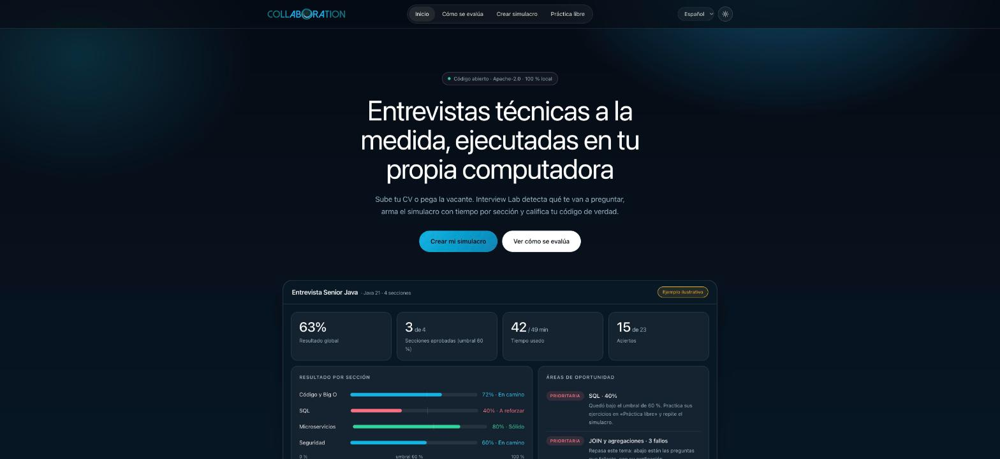
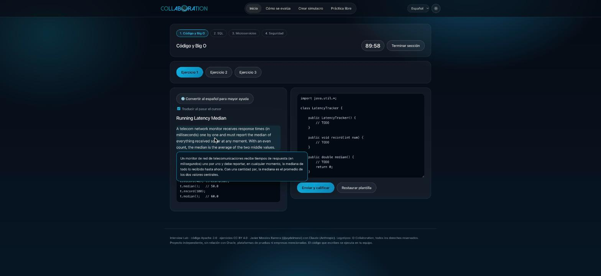
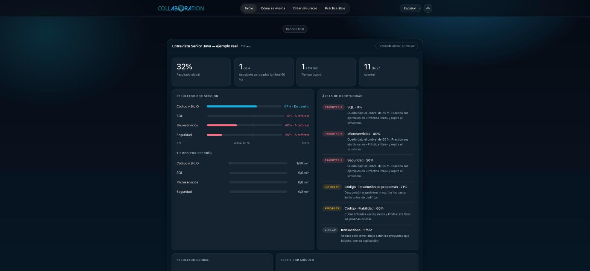
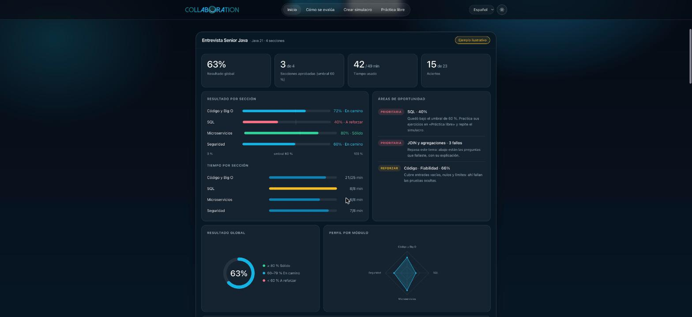

# User guide / Guía de uso

> **EN** — What Interview Lab is for, and how to use it step by step.
> **ES** — Para qué sirve Interview Lab y cómo usarlo paso a paso.

## What is it for? / ¿Para qué sirve?

**EN** — Interviews fail for predictable reasons: no IDE, time pressure, forgotten edge cases, unfamiliar question styles, and reading the statement too fast.
Interview Lab lets you rehearse exactly that. You describe the role (paste a job description or your CV), choose seniority, language and modules, and the app builds a **timed exam, section by section**, from a bank of coding exercises (hidden tests), output questions, and multiple-choice questions on SQL, QA (TDD/BDD), microservices, DevOps, architecture, security and Unix. At the end you get a report with the topics to reinforce.

**ES** — Las entrevistas fallan por razones previsibles: sin IDE, con prisa, casos borde olvidados, formatos de pregunta nuevos y leer el enunciado demasiado rápido.
Interview Lab te deja ensayar justo eso. Describes el puesto (pegas la vacante o tu CV), eliges seniority, lenguaje y módulos, y la app arma un **examen con temporizador por sección** con ejercicios de código (pruebas ocultas), preguntas de salida y preguntas de opción múltiple de SQL, QA (TDD/BDD), microservicios, DevOps, arquitectura, seguridad y Unix. Al final recibes un reporte con los temas por reforzar.



## 1. Create a simulation / Crear un simulacro

1. **Paste or upload** the job description or your CV (`.txt`, `.md`, `.docx`; for PDF copy and paste the text). Press **Analyze**. It runs locally; nothing is stored or sent.
2. **Check the detected values** (seniority, language and version, modules). They are only suggestions: change anything.
3. Pick a **pace** (tight −20 %, standard, relaxed +25 %) and, optionally, a name.
4. *(Optional)* **My bank**: paste up to 5 links or your own notes. They become multiple-choice questions and flashcards stored only in your workspace. Tick the banks you want to include.
5. Press **Create simulation**. You can retake any past simulation from *My simulations*.

Notes: coding exercises and "predict the output" are **Java-only** for now (Python and other languages get the conceptual modules). The AI module is marked *coming soon*.

## 2. Take the exam / Resolver el examen

- Each **section has its own timer**: coding = each exercise's own limit; questions = 1.5 min each (1 min for output questions).
- **Coding sections:** read the statement, write code (no autocomplete, `Tab` inserts spaces), press **Submit and grade**. You see which hidden tests failed, why, and how to improve; you can resubmit. The best score per exercise counts.
- **Question sections:** answer everything and press **Finish section** (or wait for the timer). You get the right answer and an explanation for every item.
- **Flashcards** (from your bank): reveal the answer, then rate yourself *I knew it / I did not*.
- If the time ends, the section is submitted automatically.
- You can close or reload the page and **resume** where you were: the timer, your marked answers and your coding scores are kept. A section you already finished stays closed (you continue with the next one, you cannot redo it), and the run is stored in your history as soon as the last section is finished, even if you never open the final report. If saving to the history fails, the report shows a notice with a **Retry saving** button.



### Spanish help for English statements / Ayuda en español
Statements are in English like real interviews, but misreading them is a common cause of failure.
- **🌐 Convertir al español para mayor ayuda** shows the whole statement in Spanish (and back).
- **Traducir al pasar el cursor** keeps the English text and shows the Spanish paragraph in a pop-up when you hover (tap on touch screens).

## 3. Read your report / Leer el reporte



The report is a dashboard (the landing page shows an *illustrative example* of it before you start, so you know how you will be scored):

- **Overall result**: the mean of the section scores. Each section is 0–100 %; **60 % or more passes**, 80 % or more is *solid*.
- **KPIs**: sections passed, time used versus allotted, correct answers (hidden tests for code, questions for the rest).
- **Per-section bars** with the 60 % line, **time per section**, and a **radar profile** by module.
- **Opportunity areas**, ordered by priority: sections under 60 %, code categories under 80 % (problem solving, reliability, language knowledge) and the topics of the questions you missed.
- **Questions to review**: each missed question with the right answer and the explanation.
- **Save as PDF** prints the dashboard in a light, ink-friendly style.



Use *Retake this simulation* or create another one focused on the weak topics.

### Light and dark mode / Modo claro y oscuro
The button next to the language selector switches between light and dark mode (it follows your system until you choose). The matching Collaboration logo is shown automatically.

### History / Historial
The **History** page (top menu) keeps every finished simulation and every code/quiz submission in a local SQLite file (`workspace/ilab.db`): overall trend, evolution per module (weakest first), the topics you miss most, time used vs allotted, per-exercise progress, and each past simulation with its missed questions. It starts filling as soon as you finish your first simulation.

## 4. Free practice / Práctica libre
*Free practice* (top menu) opens any single exercise or the output quiz with its own timer, without building an exam.

## 5. Add your own exercises / Agregar tus ejercicios
```bash
python3 tools/new_problem.py my-exercise "My Title" --domain retail
python3 tools/validate.py my-exercise
```
Your exercise appears in the selectors under *My problems*. Read the [content guidelines](CONTENT-GUIDELINES.md) first: write your own wording and use a business **sector** instead of real company names. You are responsible for the rights of what you add.

## 6. Your data / Tus datos
Everything lives in `workspace/` (git-ignored): `problems/`, `banks/`, `exams/` and `runs/` (attempts and scores). Delete the folder to delete your history.
