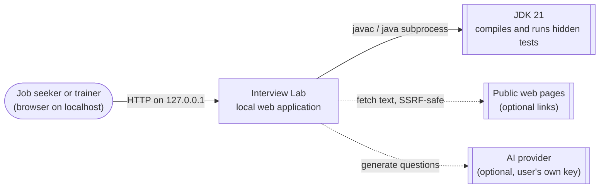
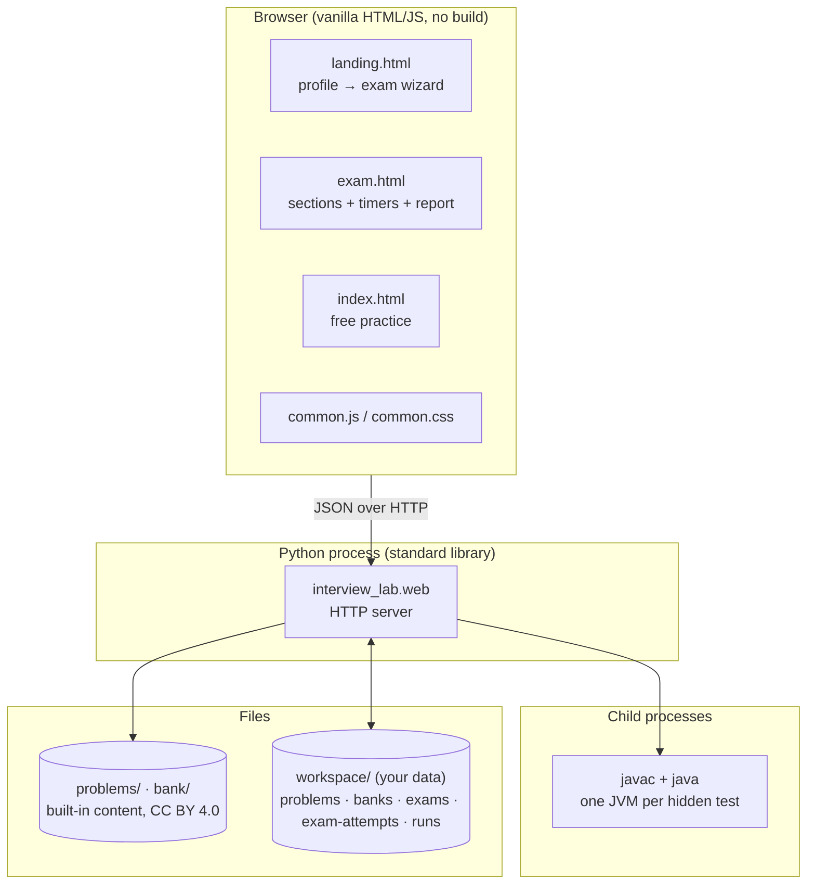
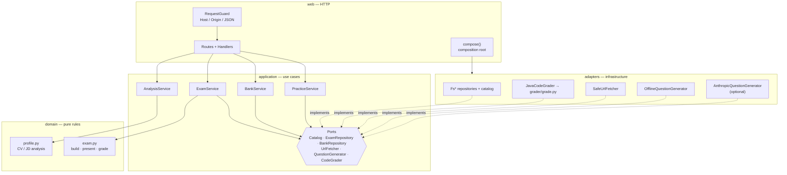
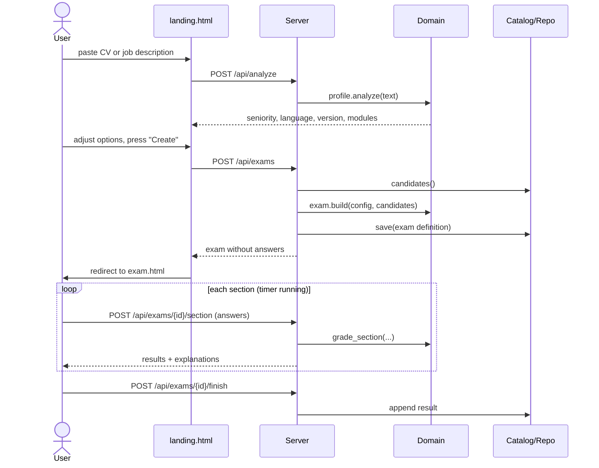
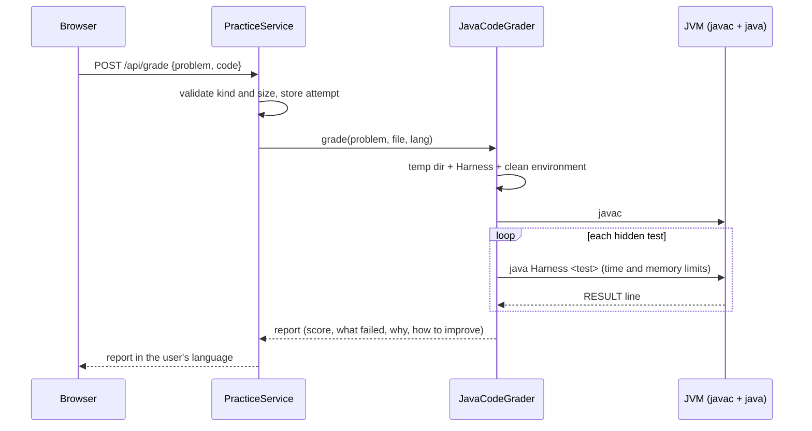
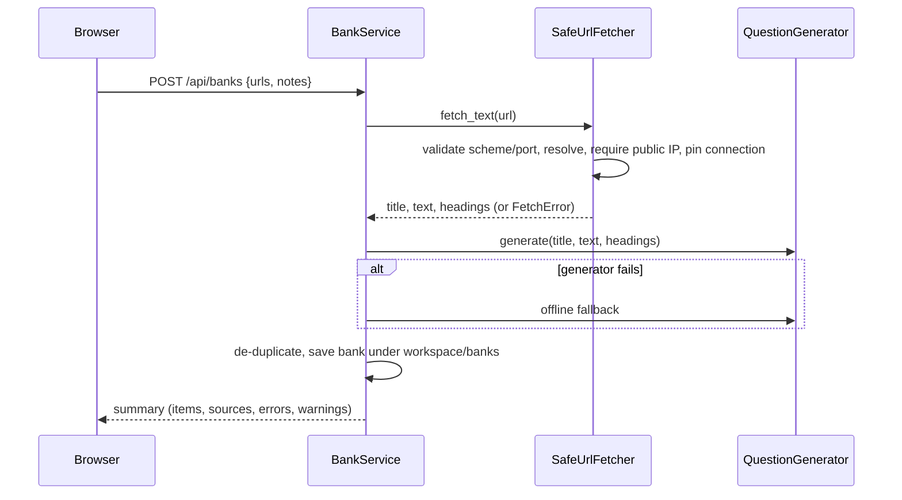
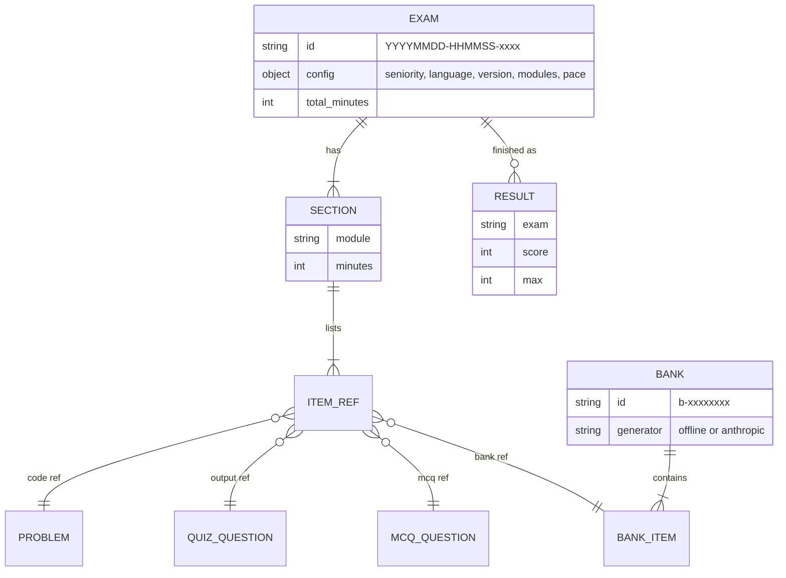
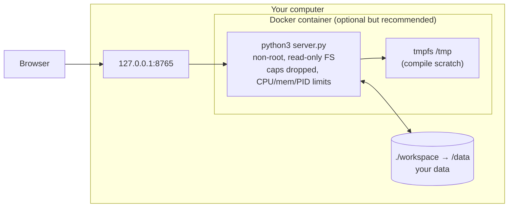

# Architecture / Arquitectura

> **EN** — How Interview Lab is built and why. Every significant decision has an [ADR](adr/README.md).
> **ES** — Cómo está construido Interview Lab y por qué. Cada decisión importante tiene su [ADR](adr/README.md).

## 1. Goals and quality attributes

| Attribute | What it means here | How it is achieved |
|---|---|---|
| **Privacy (local-first)** | CVs, attempts and notes never leave the machine unless the user opts in. | No accounts, no telemetry, no database server; offline analysis; optional AI is off by default ([ADR-0002](adr/0002-local-first-single-process.md), [ADR-0011](adr/0011-optional-ai-generator-port.md)). |
| **Security** | The app compiles and runs code and downloads links. | Same-origin guard, SSRF-safe fetch, clean environment for graded code, hardened container ([ADR-0004](adr/0004-jvm-subprocess-grading-and-container-hardening.md), [ADR-0008](adr/0008-same-origin-guard.md), [ADR-0009](adr/0009-ssrf-safe-link-fetching.md)). |
| **Portability** | One command to run on Linux, macOS, Windows (WSL2). | Standard library only; Docker image; no build step ([ADR-0013](adr/0013-no-build-step-frontend.md)). |
| **Testability** | Rules testable without server, files or JVM. | Hexagonal layering with injected ports ([ADR-0003](adr/0003-hexagonal-layering.md)). |
| **Extensibility** | Users add exercises; teams add modules or generators. | Content is data (folders + JSON), generators are a port ([ADR-0005](adr/0005-content-model.md), [ADR-0011](adr/0011-optional-ai-generator-port.md)). |
| **Fairness & integrity** | Answers never reach the browser; exams are reproducible. | Server-side grading, seeded shuffles ([ADR-0007](adr/0007-exam-as-reproducible-definition.md)). |

Non-goals: multi-user hosting, cheating prevention (timers are client-side, see [ADR-0014](adr/0014-client-side-section-timers.md)), sandboxing hostile code.

## 2. System context (C4 level 1)

## 3. Containers (C4 level 2)

Interview Lab is a **single process** plus a JVM child process per graded test, and a folder of JSON/Markdown files.

## 4. Components and layering (C4 level 3)

Dependencies point **inward**: `web → application → domain`. Adapters implement the ports declared by the application layer and are wired only in the composition root (`interview_lab/web/app.py`).

## 5. Key flows

### 5.1 Build and take a tailored exam

### 5.2 Grade code on the JVM

### 5.3 Add a link to "My bank"

## 6. Data model

All data are JSON files (see [ADR-0010](adr/0010-json-files-for-persistence.md)).

An exam stores only **references** to items, never the items or answers; it is therefore small, reproducible and safe to expose (the browser receives items without answers).

## 7. Deployment

The port is published **only on loopback**. Exposing it to a network is explicitly unsupported (see [SECURITY](../SECURITY-MODEL.md)).

## 8. Front-end design layer (landing, brand, tokens)

The browser side is still static files with no build step ([ADR-0013](adr/0013-no-build-step-frontend.md)); the "Pro" redesign adds a thin design layer on top, all of it declarative:

| Piece | Where | Decision |
|---|---|---|
| Design tokens: blues, the three arc colours, gold, `--font-display` | `web/common.css` (both themes) | [ADR-0015](adr/0015-ui-design-system-and-results-dashboard.md), [ADR-0023](adr/0023-hosted-heading-typeface-and-gold-action-colour.md) |
| Heading typeface (Outfit, OFL, 24 KB) | `web/fonts/` + `ORIGEN.md`, served by `ASSETS` in `interview_lab/web/handlers.py` | [ADR-0023](adr/0023-hosted-heading-typeface-and-gold-action-colour.md) |
| Isotype definition (one `<defs>`, reused with `<use>`) and the brand-gated bar | `web/common.js` (`ISOTYPE_DEFS`, `installIsotype`, `brandBlock`), `isotype` key in `web/brand/brand.json` | [ADR-0022](adr/0022-scroll-driven-isotype-without-libraries.md) |
| Scroll-driven "O" layer (CSS keyframes tied to `animation-timeline`, one passive-scroll fallback) | `web/landing.html` (layer), `web/common.css` (keyframes), `web/landing.js` (`orbit()`) | [ADR-0022](adr/0022-scroll-driven-isotype-without-libraries.md) |

The landing page itself (`landing.html` + `landing.js`) is the profile → exam wizard plus marketing blocks whose figures are read from `/api/modules` and `/api/brand`, never typed by hand. `brand.json` declares the company name, tagline, PNG logos, the optional `isotype` and an optional `link` (empty until the owner confirms the domain).

## 9. Repository map

| Path | Layer / purpose |
|---|---|
| `interview_lab/domain/` | Pure rules: exam building/grading, CV/JD analysis |
| `interview_lab/application/` | Use cases, ports, errors |
| `interview_lab/adapters/` | Filesystem, JVM grader, URL fetcher, generators |
| `interview_lab/web/` | HTTP server, routes, security guard, composition root |
| `grader/` | JVM grading runtime (CLI + Java `Runner`/`Check`) |
| `problems/`, `bank/` | Built-in content (CC BY 4.0) |
| `web/` | Static front end (HTML, JS, CSS, brand, hosted heading typeface in `fonts/`) |
| `tools/` | `new_problem.py`, `validate.py`, `gen_quiz.py` |
| `tests/` | Domain, adapter, API and JVM tests |
| `docs/` | Architecture, ADRs, install, user guide, API, security model |

---

## Resumen (ES)
El sistema es **local primero**: un solo proceso Python (solo biblioteca estándar) que sirve páginas estáticas y una API JSON, lanza una JVM por prueba oculta y guarda todo en archivos JSON. El código sigue una **arquitectura hexagonal** (web → aplicación → dominio; los adaptadores implementan los puertos). Los exámenes guardan solo referencias a los ejercicios, las respuestas nunca llegan al navegador y el reparto de opciones es reproducible. Las decisiones están en los ADR enlazados arriba.
